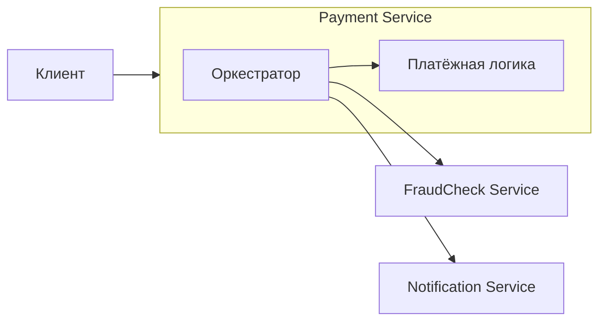
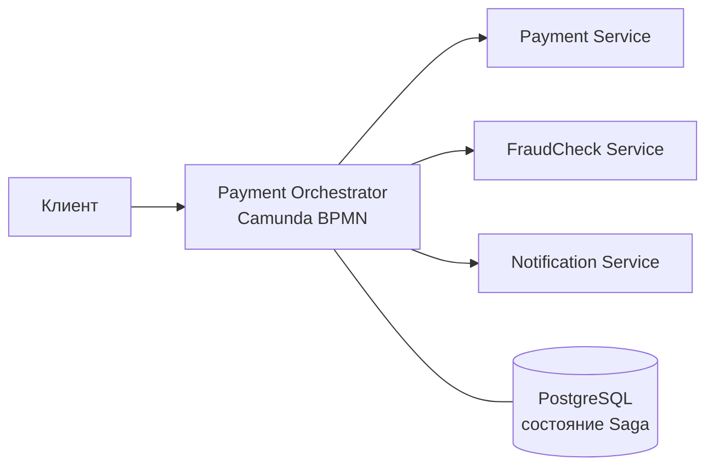

# ADR: Где разместить оркестрацию платёжной Saga

## Общая информация

1. Родительский артефакт — реестр транзакций Saga ([Task1/saga-steps.md](../Task1/saga-steps.md)), таблица переходов платежа ([Task2/payment-transitions.md](../Task2/payment-transitions.md))
2. Автор ADR — DwaneWade123
3. Статус — Принят
4. Согласующие — отдел «Платёжные сервисы», команда «Безопасность», команда «DevOps/SRE», отдел «Финансы»

## Контекст

Оплата заказа в OrchestrPay проходит через несколько сервисов:

- **Payment Service** — создаёт платёж, списывает и возвращает деньги, переводит их контрагенту;
- **FraudCheck Service** — проверяет платёж (автоматически или руками оператора);
- **Notification Service** — шлёт уведомления клиенту и службе безопасности.

Команда выбрала Saga с оркестрацией: один участник (оркестратор) командует остальными, помнит, на каком шаге платёж, и при ошибке запускает возврат.

Вопрос: **где разместить оркестратор — внутри Payment Service или в отдельном сервисе?**

Что важно для выбора:

- деньги не должны «зависать» между системами, возврат должен проходить сам, без поддержки;
- платёж может ждать ручной проверки до 20 минут, есть таймеры cut-off;
- бизнесу и службе безопасности нужно видеть, на каком шаге платёж и где он застрял;
- 90% успешных платежей должны проходить быстрее 5 секунд;
- для оркестрации компания уже выбрала Camunda BPMN, а для хранения — PostgreSQL;
- над разными сервисами работают разные команды.

## Рассмотренные варианты

### Вариант №1 «Оркестратор внутри Payment Service»

Логика всего процесса живёт в Payment Service. Он сам делает свои шаги (списание, перевод, возврат) и сам вызывает FraudCheck и Notification. Состояние Saga хранится в базе Payment Service.

### Вариант №2 «Отдельный сервис-оркестратор»

Создаётся отдельный сервис Payment Orchestrator на Camunda BPMN. Он только управляет процессом: по очереди вызывает Payment, FraudCheck и Notification, ждёт ответов, запускает таймеры и возвраты. Сами сервисы ничего не знают о процессе целиком и делают только свою работу. Состояние Saga хранится в базе оркестратора (PostgreSQL).

## Сравнение альтернатив

| Вариант решения | Преимущества | Недостатки |
|---|---|---|
| Вариант №1 «Оркестратор внутри Payment Service» | - Меньше сервисов, проще запустить и поддерживать - Свои шаги (списание, возврат) вызываются без сети — чуть быстрее - Одна команда отвечает за весь процесс | - Payment Service делает две разные работы: платежи и управление процессом. Код растёт и усложняется - Любое изменение процесса (новая проверка, другой таймер) требует выпуска Payment Service — ключевого сервиса с деньгами - Падение Payment Service останавливает и процесс, и учёт денег - Ожидание ручной проверки (20 минут) и таймеры нагружают платёжный сервис - Другим командам (Безопасность, Финансы) сложнее видеть ход платежа и менять процесс - Payment Service начинает зависеть от FraudCheck и Notification |
| Вариант №2 «Отдельный сервис-оркестратор» | - Каждый сервис делает одну работу: оркестратор — процесс, Payment — деньги - Процесс описан схемой в Camunda: видно, на каком шаге каждый платёж и где он застрял - Таймеры, ожидания, повторы и возвраты из коробки в Camunda - Процесс можно менять, не трогая Payment Service - Оркестратор и сервисы масштабируются отдельно - Состояние Saga хранится в одном месте, после сбоя процесс продолжается с нужного шага | - Ещё один сервис: его нужно разворачивать, мониторить и резервировать - Лишние сетевые вызовы — немного дольше каждый шаг - Оркестратор становится важной точкой: если он упадёт, новые платежи не пойдут (нужен запуск в нескольких копиях) - Команде нужно освоить Camunda |

## Принятое решение

Выбран **Вариант №2 «Отдельный сервис-оркестратор»**.

Почему:

1. **Деньги не зависнут.** Camunda хранит, на каком шаге каждый платёж. Если что-то упало, процесс продолжится с того же места, а возврат будет повторяться, пока не пройдёт.
2. **Долгие ожидания и таймеры.** Ручная проверка до 20 минут и cut-off — это встроенные возможности Camunda. Payment Service не нужно держать эту логику у себя.
3. **Прозрачность.** Бизнес и служба безопасности видят ход каждого платежа на схеме процесса.
4. **Безопасность изменений.** Процесс можно менять, не выпуская заново сервис, который работает с деньгами.
5. **Скорость в пределах нормы.** Несколько лишних сетевых вызовов внутри одной сети занимают миллисекунды. Это не мешает уложиться в 5 секунд.

Как снижаем минусы:

- оркестратор запускается в нескольких копиях, его состояние хранится в PostgreSQL;
- DevOps/SRE ставят мониторинг на зависшие и долго идущие процессы;
- все вызовы сервисов идемпотентны: повторный запрос не спишет и не вернёт деньги дважды.
